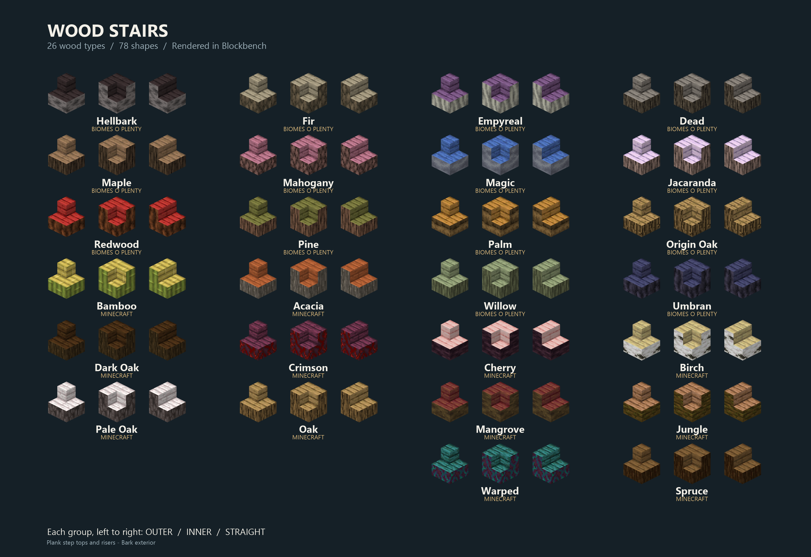
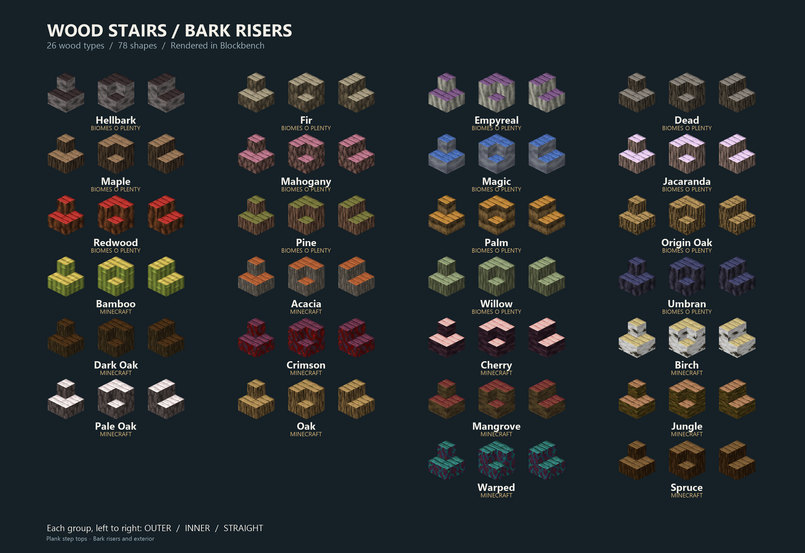

# Wood Stairs — Fabric, Minecraft 26.3

**Wood Stairs** adds wood stair variants with plank step surfaces and natural bark sides for every vanilla wood family, plus Biomes O' Plenty compatibility.

Maintained by **LieutenantKhaos**. Internal mod ID: `bark_stairs`.

## Download

[Download on CurseForge](https://www.curseforge.com/minecraft/mc-mods/wood-stairs)
| [GitHub releases](https://github.com/LieutenantKhaos/Wood-Stairs/releases)
| [Changelog](CHANGELOG.md)

| Minecraft | Mod version | Loader | Source |
|---|---|---|---|
| 26.3 | 1.1.0 | Fabric | [minecraft-26.3](https://github.com/LieutenantKhaos/Wood-Stairs/tree/minecraft-26.3) |
| 26.2 | 1.0.0 | Fabric | [main](https://github.com/LieutenantKhaos/Wood-Stairs/tree/main) |

## Features

- 12 vanilla wood families and 14 Biomes O' Plenty wood families.
- Straight, inner-corner, and outer-corner stair shapes.
- Vanilla stair placement, upside-down stairs, and waterlogging.
- Plank tops and vertical risers with bark on the exterior sides.
- Optional built-in **Wood Stairs (Alternative)** pack for bark on the vertical risers.
- Optional built-in **Wood Stairs (Programmer Art)** pack for classic textures.

## Install

This branch targets **Minecraft 26.3**, **Java 25**, **Fabric Loader 0.20.1+**, and **Fabric API 0.165.0+26.3**.

Download the mod JAR for your Minecraft version and put it in `mods`, replacing any earlier Wood Stairs JAR. Install only one version at a time. Biomes O' Plenty is optional; its wood stairs are registered only when it is installed.

Wood Stairs adds blocks and items, so install the mod on both client and server when playing multiplayer.

## Built-in resource packs

Open **Options > Resource Packs** to select a style. Both packs are already included in the mod JAR; no separate ZIP is needed.

- **Default:** plank tops and vertical risers; bark exterior sides.
- **Wood Stairs (Alternative):** plank tops; bark exterior sides and vertical risers.
- **Wood Stairs (Programmer Art):** follows Minecraft's Programmer Art textures. Enable Minecraft's Programmer Art pack too. Vanilla families only.

If using Alternative and Programmer Art together, place **Alternative above Programmer Art**.

## Preview

### Default

### Alternative

The renders show all 26 wood families in outer / inner / straight order. Blockbench project files are not included.

## Build

Use Java 25 and the included Gradle wrapper:

Windows: `gradlew.bat clean build`

Other systems: `./gradlew clean build`

Output: `build/libs/wood-stairs-1.1.0.jar`.

Sources and resource definitions are under `src/main`. The Java entrypoint was recovered from the supplied compiled mod and rebuilt against Fabric; registry IDs and existing block behavior are retained.

See [VALIDATION.md](VALIDATION.md) for checks and remaining in-game testing.

## Credits and license

Design and maintenance by LieutenantKhaos, with AI assistance for development, debugging, and documentation. The supplied mod declares **CC0-1.0**, preserved in [LICENSE](LICENSE). Minecraft and Biomes O' Plenty textures shown in the previews belong to their respective authors; their texture PNGs are not bundled with this project.

